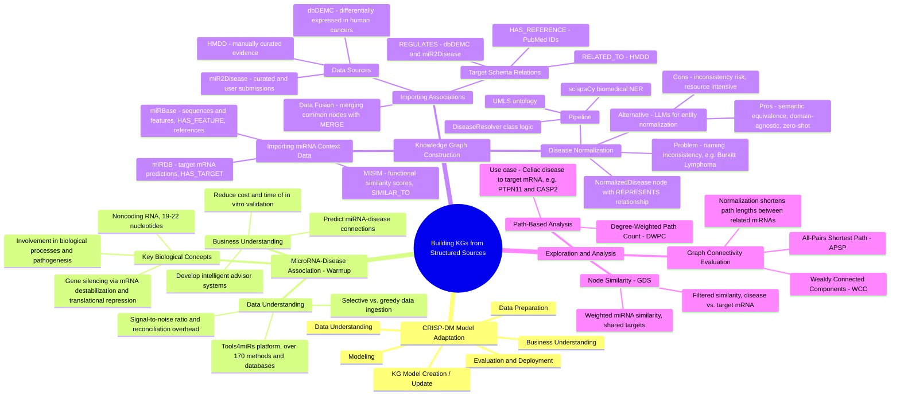

## Build Knowledge Graph from Structured Sources

### Getting Started

#### Install Requirements
This project's `Makefile` assumes you have a virtual environment folder called `venv` 
in the repository root. You can edit the `Makefile` and redefine the `PIP` variable
in the first line to match your specific configuration.
```shell
make init
```

#### Download the Datasets
Run this command to create a `dataset` folder in the repository root containing 
all the required raw data:
```shell
make download
```

#### Import the Datasets
Run this command to execute the importer code for each dataset:
```shell
make import
```

#### Reconcile Diseases
Run this command to use the scispacy model to resolve diseases from different datasets:
```shell
make reconciliate
```

### Notes for Mac Users
If you're having trouble installing libraries related to scispacy, you can run the code from this chapter via a Docker container by following these steps:

#### Create a Suitable Container 
Create an ephemeral container called venv_ch5:

```bash
docker run -e NEO4J_URI=bolt://host.docker.internal:7687 -e PYTHONPATH=../../ \
       -w /work/chapters/ch04_Appendix_C -d -it --name venv_ch5 -v $PWD/../../:/work python:3.9-slim
```
This command assumes you'll use a Neo4j instance running on your local machine. 
The container will mount this repository under `/work` and set the working directory accordingly.

#### Update the Makefile
Change the first lines of the Makefile to:

```makefile
PIP=docker exec -it venv_ch5 pip  
PYTHON=docker exec -it venv_ch5 python
```

#### Run the Make Commands
Now you can run the make commands as usual:
```bash
make init     # Install required libraries inside the container
make download # Download datasets (data will be available within the container)
make import   # Execute the import in the container (data will be written to the Neo4j instance on your local machine)
make reconciliate # Execute reconciliation within the container (data will be written to the Neo4j instance on your local machine)
```

### Appendix C: building KGs from structured sources (mind map)

[Appendix C](context/Appendix%20C-building-kgs-from-structured-sources.pdf) is the book's worked example of building
a graph from structured sources: miRNA-disease associations (HMDD, dbDEMC, miR2Disease), disease normalization,
miRNA context data (miRBase, miRDB, MISIM) and a connectivity / similarity / DWPC analysis. The mind map below was
generated from the PDF with NotebookLM.


