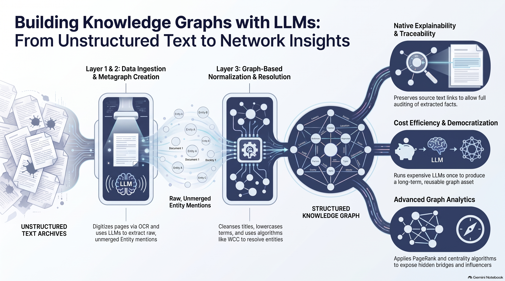
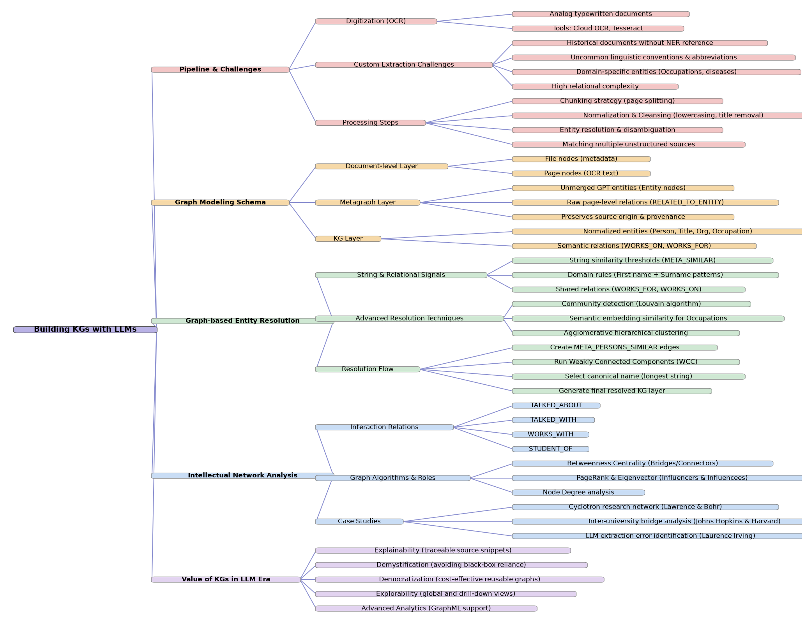

## Building knowledge graphs with Large Language Models

### Getting started

#### Install requirements
This chapter's `Makefile` assumes you have a virtual environemnt folder called `venv` 
at the reopository root folder. You can edit the`Makefile` and redefine the `PIP` variable
at the first line to match your configuration.
```shell
make init
```

#### Running with Docker

No local Python environment is needed. Configure the LLM first (below), then from this folder:

```shell
make docker-up           # start Neo4j 5 + APOC + GDS (http://localhost:7474, neo4j / password); the importer container then runs the pipeline once
make docker-logs         # follow / replay the importer log (the exited container keeps it)
make docker-import       # run the pipeline again in a fresh importer container (safe to repeat)
make docker-logs-neo4j   # follow the Neo4j log
make docker-down         # stop (add -v to `docker compose down` to wipe the graph)
```

The `importer` container is a regular compose service, not a throw-away one: it stays in `docker ps -a` as `ch06-importer` 
after it finishes, so its complete log can be read at any time with `docker logs ch06-importer`. 
It reads the diaries and prompts from `../../data`, where it also reads and writes the LLM cache. 
With the cache populated, no OpenAI key is needed. 
Neo4j Community has no `NODE KEY` constraints, so the importer logs a warning and creates `IS UNIQUE` constraints instead.

#### Configure the LLM
The importer reads `OPENAI_KEY`, `OPENAI_BASE_URL` and `OPENAI_MODEL` from a `.env` file in this folder, 
which is git-ignored. Create it from the template and set your key (without quotes around values):
```shell
cp .env.example .env
```

`LOG_LEVEL` (`DEBUG`, `INFO`, `WARNING`, `ERROR`; default `INFO`) controls the importer's logging. 
Logs are written to stdout, so they show up in `docker logs` / `docker compose logs -f`. 
`INFO` shows every stage with its duration, per-page progress, cache hits, LLM token usage, the nodes and 
relationships each Cypher statement changed, and graph totals after each stage; `DEBUG` adds the raw LLM answers.

#### Import the datasets
Run this command to execute the importer code for each dataset.
```shell
make import
```

##### Cached LLM responses

Once loaded, diary entries are processed using OpenAI ChatGPT by default. 
The responses from ChatGPT are cached in the `data/cached_llm`  folder to avoid executing the same prompt multiple
times and incurring additional costs. 
This caching mechanism is enabled by default, and a populated version of the cache is included in this Git repository, 
allowing the entire process to run even without a valid OpenAI key.

The caching mechanism is simple and tied to the name of the diary page identifier. 
If the model or prompt is changed since the last time the cache was populated, the cache will not be invalidated, 
and unmodified responses may be used. 
In such scenarios, it is sufficient to remove the contents of the cache folder or copy them to another location.

#### Importer code structure

The importer in `importer/` is split by aspect. `ingest_and_process.py` is the entry point run by `make import`;
see [importer/CALL_DIAGRAM.html](importer/CALL_DIAGRAM.html) for class, sequence and data-flow diagrams.

| File | Aspect |
|---|---|
| `ingest_and_process.py` | Entry point only. `make import` runs it. |
| `diaries_ingest.py` | Stage 1: constraints and indexes, plus loading `File` and `Page` nodes. |
| `llm_extraction.py` | Stage 2: prompt loading, OpenAI call with caching, output parsing, and the retry pass. |
| `graph_store.py` | Writes the raw LLM entities and relations, plus `cleanse_stability_test`. |
| `entity_normalization.py` | Stage 3a: strips titles from person names and lowercases occupations. |
| `entity_resolution.py` | Stage 3b: person de-duplication in five steps. |
| `kg_builder.py` | Stage 3c: builds the final clean graph. |
| `graph_analytics.py` | Stage 4: graph algorithms (components, centrality, communities, influencers). |
| `full_kg.py` | `FullKG` combines the stage modules as mixins and sets the order of the stages. |
| `kg_schema.py` | Static config: title list, rename maps and the allowed-relation schema. |
| `pipeline_logging.py` | Logging setup (stdout, `LOG_LEVEL`), stage timing and the Cypher runner that logs Neo4j write counters. |
| `CALL_DIAGRAM.html` | Class structure, call sequence, data flow and a who-calls-whom table. |

## Chapter at a glance

The visuals below summarize the chapter source material in [context/building-kgs-with-llms.pdf](context/building-kgs-with-llms.pdf).
They were generated with NotebookLM.

### Infographic: from unstructured text to network insights



The infographic reads left to right and follows the data through the whole pipeline:

1. **Unstructured text archives** – the starting point is a set of scanned, typewritten historical documents (diary pages).
   They have no ready-made structure, use uncommon abbreviations and contain domain-specific names, so off-the-shelf NER does not work well.
2. **Layers 1 & 2: data ingestion and metagraph creation** – pages are digitized with OCR and split into page-sized chunks.
   Each page is sent to the LLM, which extracts raw entity mentions and the relations between them.
   The results are stored as `File` and `Page` nodes (document layer) plus unmerged `Entity` nodes linked with `RELATED_TO_ENTITY`
   (metagraph layer). Nothing is merged here, so every extracted fact stays traceable to the page it came from.
3. **Layer 3: graph-based normalization and resolution** – names are cleansed (lowercased, titles removed) and the same real-world
   person is recognized across pages. Similar mentions are linked with `META_PERSONS_SIMILAR` edges, Weakly Connected Components (WCC)
   group them, and the longest name in each group becomes the canonical one.
4. **Structured knowledge graph** – the result is the clean KG layer: normalized `Person`, `Title`, `Organization` and `Occupation`
   nodes joined by semantic relations such as `WORKS_ON` and `WORKS_FOR`.
5. **What you get out of it** (right-hand side):
   - **Native explainability and traceability** – each fact links back to its source snippet, so it can be audited.
   - **Cost efficiency and democratization** – the expensive LLM run happens once and produces a reusable graph asset.
   - **Advanced graph analytics** – PageRank, betweenness centrality and similar algorithms reveal bridges and influencers.

### Mind map: concepts and structure



An interactive version (pan, zoom, expand and collapse branches) is available in
[context/ch06_mind_map.html](context/ch06_mind_map.html); the raw data is in [context/ch06_mind_map.json](context/ch06_mind_map.json).

The mind map has five main branches:

| Branch | What it covers |
|---|---|
| **Pipeline & Challenges** | OCR digitization (cloud OCR, Tesseract); why custom extraction is hard (no NER reference for historical text, abbreviations, domain entities, relational complexity); processing steps: chunking, normalization, entity resolution, matching several unstructured sources. |
| **Graph Modeling Schema** | The three layers: *document* (File and Page nodes), *metagraph* (unmerged GPT entities and raw page-level relations, preserving provenance) and *KG* (normalized entities and semantic relations). |
| **Graph-based Entity Resolution** | Signals: string-similarity thresholds (`META_SIMILAR`), domain rules (first name + surname patterns) and shared relations. Advanced techniques: Louvain community detection, embedding similarity for occupations, agglomerative clustering. Flow: create similarity edges, run WCC, pick the canonical name, generate the resolved KG layer. |
| **Intellectual Network Analysis** | Relations (`TALKED_ABOUT`, `TALKED_WITH`, `WORKS_WITH`, `STUDENT_OF`); algorithms and the roles they reveal (betweenness = bridges, PageRank/eigenvector = influencers, degree); case studies: the cyclotron research network (Lawrence and Bohr), inter-university bridges (Johns Hopkins and Harvard) and spotting an LLM extraction error (Laurence Irving). |
| **Value of KGs in the LLM Era** | Explainability, demystification (no black-box reliance), democratization (cheap, reusable graphs), explorability (global and drill-down views) and advanced analytics (GraphML). |

These branches map directly to the code in this chapter: the importer in [importer/](importer/) builds the document and metagraph
layers, and the listings in [listings/](listings/) normalize persons and occupations (6.1), query the influence network (6.2) and trace KG nodes and relationships back to the staging graph and diary pages (6.3-6.6).
