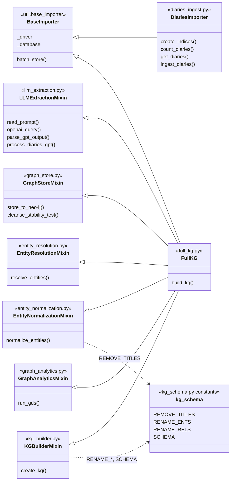
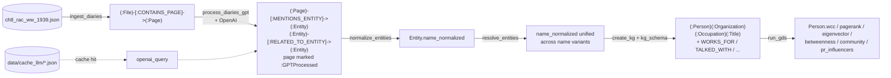

# ch06 importer – module map and call diagram

Entry point: `ingest_and_process.py` (run with `make import`). The code is split by aspect;
`FullKG` is assembled from mixins that all share the Neo4j driver of `BaseImporter`.

## 1. Module / class structure



## 2. Call sequence of a full run

```mermaid
sequenceDiagram
    autonumber
    participant Main as ingest_and_process.py (__main__)
    participant DI as DiariesImporter
    participant KG as FullKG
    participant LLM as LLMExtractionMixin
    participant ST as GraphStoreMixin
    participant NM as EntityNormalizationMixin
    participant ER as EntityResolutionMixin
    participant KB as KGBuilderMixin
    participant AN as GraphAnalyticsMixin
    participant OAI as OpenAI API
    participant N4J as Neo4j

    Note over Main,N4J: STAGE 1 - load pages
    Main->>DI: DiariesImporter(argv)
    DI->>N4J: create_indices() constraints + text indexes
    Main->>DI: ingest_diaries(ch8_rac_ww_1939.json)
    DI->>DI: count_diaries(), get_diaries()
    DI->>N4J: batch_store: File -CONTAINS_PAGE-> Page

    Note over Main,N4J: STAGES 2-3 - build the KG
    Main->>KG: FullKG(argv); set key/url/model/cache_folder
    Main->>KG: build_kg(prompt_path)

    rect rgb(235, 245, 255)
    Note over KG,OAI: STAGE 2 - LLM extraction
    KG->>LLM: read_prompt(prompt_path)
    KG->>LLM: process_diaries_gpt(QUERY_READ, prompt, n_docs=100)
    LLM->>N4J: read pages not yet :GPTProcessed
    loop each page
        LLM->>LLM: openai_query() (cache hit? return cached JSON)
        LLM->>OAI: chat.completions.create
        LLM->>LLM: parse_gpt_output()
        alt parsed OK
            LLM->>ST: store_to_neo4j(entities, relations, run)
            ST->>N4J: Entity nodes, title entities, RELATED_TO_ENTITY
        else failed
            LLM->>LLM: remember page for retry
        end
    end
    loop each failed page (retry once, cache key + "_retry")
        LLM->>OAI: openai_query()
        LLM->>ST: store_to_neo4j(whatever parsed)
    end
    end

    rect rgb(240, 255, 240)
    Note over KG,N4J: STAGE 3 - normalise, resolve, create KG
    KG->>NM: normalize_entities()
    NM->>N4J: set name_normalized (strip titles / lowercase)
    KG->>ER: resolve_entities()
    ER->>N4J: same page / previous page surname -> full name
    ER->>N4J: META_SIMILAR, META_RESOLVED_PER, META_PERSONS_SIMILAR
    ER->>N4J: GDS WCC -> longest name per cluster
    KG->>KB: create_kg()
    KB->>N4J: delete old KG, MERGE clean nodes + rels per SCHEMA
    KB->>N4J: SIMILAR_ORGANIZATION / SIMILAR_OCCUPATION
    end

    rect rgb(255, 248, 235)
    Note over Main,N4J: STAGE 4 - graph analytics
    Main->>KG: run_gds()
    KG->>AN: run_gds()
    AN->>N4J: project, WCC, largest component
    AN->>N4J: PageRank, eigenvector, betweenness, Louvain
    AN->>N4J: influencer projection -> pr_influencers, eigen_influencers
    end
```

## 3. Data flow between stages



## 4. Who calls whom (flat list)

| Caller | Callee | Module |
|---|---|---|
| `__main__` | `DiariesImporter.__init__` → `create_indices` | diaries_ingest |
| `__main__` | `DiariesImporter.ingest_diaries` → `count_diaries`, `get_diaries`, `batch_store` | diaries_ingest |
| `__main__` | `FullKG.build_kg` | full_kg |
| `build_kg` | `read_prompt` | llm_extraction |
| `build_kg` | `process_diaries_gpt` | llm_extraction |
| `process_diaries_gpt` | `openai_query`, `parse_gpt_output`, `store_to_neo4j` | llm_extraction → graph_store |
| `build_kg` | `normalize_entities` | entity_normalization |
| `build_kg` | `resolve_entities` | entity_resolution |
| `build_kg` | `create_kg` | kg_builder |
| `__main__` | `run_gds` | graph_analytics |
| *(unused)* | `cleanse_stability_test` | graph_store |
