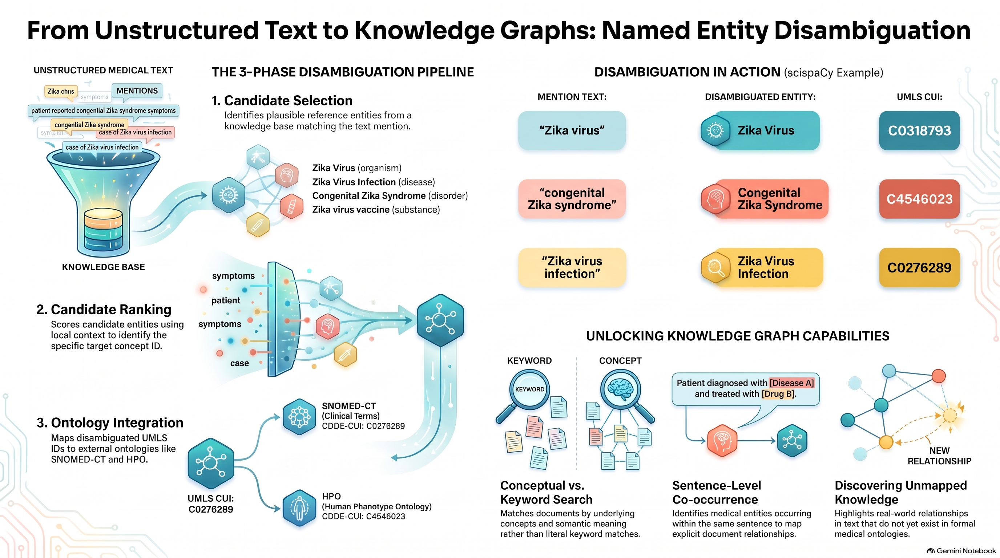
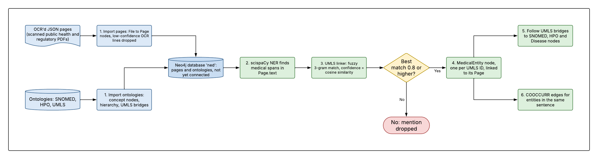
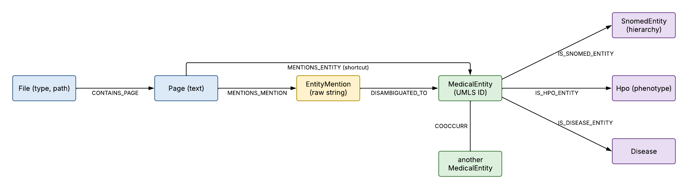

## Named Entity Disambiguation

### Chapter at a glance



The infographic summarizes the chapter source material in [context/named-entity-disambiguation.pdf](context/named-entity-disambiguation.pdf).
It was generated with NotebookLM. It shows the general three-step disambiguation pipeline (candidate selection, candidate ranking,
ontology integration). Note that the scispaCy linker used in this chapter ranks candidates by string similarity only and does not use the
surrounding context; context-aware ranking is what chapter 8 adds with an LLM.

Named entity disambiguation (NED) turns the surface strings found in a text ("heart attack", "MI", "myocardial infarction")
into one canonical concept with a unique ID. The chapter builds a medical knowledge graph in the Neo4j database `ned` in two phases.



The blue boxes are the import phase and the green boxes the disambiguation phase. The yellow diamond is the confidence check:
a mention is kept only if its best UMLS match scores 0.8 or higher.

**Phase 1: import (`make import`).** No NLP is involved.
- *Ontologies:* SNOMED (concepts and the `SNOMED_IS_A` hierarchy), HPO (phenotypes and diseases) and UMLS. UMLS is the hub: it gives
  each concept one ID (CUI) and maps it to SNOMED, HPO and diseases (`UMLS_TO_SNOMED`, `UMLS_TO_HPO`, `UMLS_TO_DIS`).
- *Documents:* the OCR'd JSON files (public health and regulatory documents, e.g. ECDC outbreak reports and EU blood, tissue and cell
  regulations). Each page's text lines are filtered by OCR confidence, ordered by column and de-hyphenated, then stored as
  `(:File)-[:CONTAINS_PAGE]->(:Page {text})`. The `File.type` and `File.path` metadata are kept and can be used as filters.

**Phase 2: disambiguation (`make disambiguate`).**
1. *Recognize and link:* scispaCy finds medical spans in `Page.text` and links each to UMLS candidates. The linker is fuzzy string matching:
   it compares character 3-grams of the mention against all UMLS names and aliases. The `confidence` is that cosine similarity
   (how well the spelling matches), not the probability that the meaning is right. Mentions whose best candidate scores below 0.8 are dropped.
2. *Store:* `(Page)-[:MENTIONS_MENTION]->(EntityMention)-[:DISAMBIGUATED_TO {confidence}]->(MedicalEntity)`, plus the shortcut
   `(Page)-[:MENTIONS_ENTITY]->(MedicalEntity)`. Different strings with the same meaning end up on the same node.
3. *Link to the ontologies:* through the UMLS ID, each `MedicalEntity` gets `IS_SNOMED_ENTITY`, `IS_HPO_ENTITY` and `IS_DISEASE_ENTITY`
   edges where a mapping exists (not every concept is in all three), which gives access to the SNOMED hierarchy.
4. *Co-occurrence:* entities in the same sentence are joined by `COOCCURR {count, sentences}` edges.



Blue nodes come from the OCR'd documents, yellow is the raw string found in the text, green is the disambiguated concept and purple
are the ontologies it is linked to.

**What you get, and what you don't.** The result works like a medically aware search index: synonyms resolve to one concept, you can search by
category through the SNOMED hierarchy, and every entity traces back to its pages and sentences. It does not interpret the text:
the linker ignores the surrounding sentence, negation ("no cough") and timing ("for three days") are not captured, and `COOCCURR` records
that two terms appeared together, not how they are related. Chapter 8 replaces the string-matching linker with an LLM that uses the context.

### Getting started
The construction of the Knowledge Graph requires to download multiple ontologies from the Unified Medical Language System (UMLS) platform. For the access to these files, you need to sign in in the following page: https://uts.nlm.nih.gov/uts/login using one of the proposed identity providers, including Google or Microsoft. After the authentication step, you can get your API key by clicking the link "*Get Your API Key*" and copy it in the `Makefile`. Further information on the programmatic access is available here: https://documentation.uts.nlm.nih.gov/automating-downloads.html.


#### Install requirements
This chapter's `Makefile` assumes you have a virtual environemnt folder called `venv` 
at the reopository root folder. You can edit the`Makefile` and redefine the `PIP` variable
at the first line to match your configuration.
```shell
make init
```

#### Download the datasets
Run this command to create a `dataset` folder at the repository root folder containing 
the raw data required: the SNOMED and UMLS ontologies and the OCR'd JSON pages (a ~2 GB download that
unpacks to ~6 GB in `dataset/ocred_documents/`).
```shell
make download
```
This is `make download-ontologies` (SNOMED, UMLS) plus `make download-ocr` (the OCR'd pages), which you can run separately.

#### Import the datasets
Run this command to execute the importer code for each dataset.
```shell
make import
```

### Run everything with Docker
If you're having trouble installing libraries related to scispacy, or you just want a
ready-made environment, `docker-compose.yml` starts Neo4j, runs the scripts and serves the notebook.
Neo4j Enterprise (evaluation licence) is used because the chapter needs a separate `ned` database.

1. Create the config file and set your UMLS API key in `APIKEY`:
```bash
cp .env.example .env
```
2. Download the SNOMED and UMLS files and the OCR'd JSON pages (~2 GB, unpacks to ~6 GB in `dataset/ocred_documents/`) into the `dataset` folder at the repository root (once):
```bash
docker compose build pipeline && docker compose run --rm download
```
3. Start Neo4j and run the pipeline (import, then disambiguation). It runs once and takes a long time:
```bash
docker compose up -d --build
docker logs -f ch07-pipeline
```
The first disambiguation run also downloads about 1 GB of scispacy UMLS linker data (kept in a Docker volume).
Resource notes: Neo4j is configured with a 10 GB heap, so the machine needs roughly 16 GB of RAM. Disambiguation processes
the pages in batches of 10 (the book uses 50): larger batches exceed Neo4j's transaction memory on the full dataset. On the
27,609 pages it takes about 1.5 hours. Progress bars are written as lines, so `docker logs -f ch07-pipeline` shows them.
4. Open the notebook at http://localhost:8888 :
```bash
docker compose --profile notebook up -d notebook
```
Neo4j Browser is at http://localhost:7474 (login `neo4j` / `password`). To run the pipeline again use
`docker compose up -d --force-recreate pipeline`, and `docker compose --profile notebook down` stops everything.
The same steps are available as `make docker-download`, `docker-up`, `docker-logs`, `docker-notebook` and `docker-down`.
